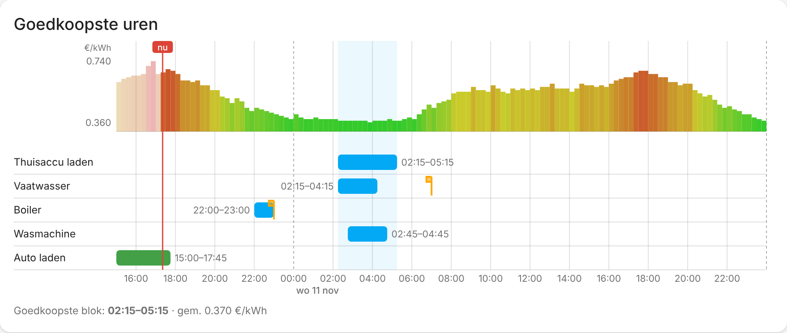

# Cheapest Hour Scheduler

Home Assistant custom integration that finds the **cheapest consecutive block of hours** in a dynamic energy price sensor and switches devices on (and off again) during that block: battery chargers, boilers, heat-pump boost, washing machines, dishwashers…



Built for the Zonneplan sensor `sensor.zonneplan_current_tariff_rounded` (15-minute prices in the `prices_today` / `prices_tomorrow` attributes), but any sensor with attributes in this format works (hourly data too):

```yaml
prices_today:
  - time: '2026-11-10 00:00:00+01:00'
    price: 0.42
  - time: '2026-11-10 00:15:00+01:00'
    price: 0.42
prices_tomorrow:
  - ...
```

## Installation

### Marketplace (Home Assistant 2026.11 and newer)
HACS is built into Home Assistant as the **Marketplace** since 2026.11.

1. Go to **Settings → Marketplace**. The first time, accept the risk notice; until you do, you can browse but not install.
2. Select **Add from link** and enter `https://github.com/rbr101/cheapest-hour-scheduler`. Adding a repository by link needs a GitHub connection: Home Assistant shows a code that you enter on GitHub.
3. Open **Cheapest Hour Scheduler** and select **Install** (twice: on the page and in the dialog).
4. Restart Home Assistant when **Settings → System → Repairs** asks for it, and refresh your browser once so the card loads.

Updates show up in the Marketplace when a new release is published. After an update, restart Home Assistant (Repairs shows a "Restart required" entry).

<details>
<summary>Older Home Assistant (before 2026.11) with HACS</summary>

1. HACS → ⋮ → *Custom repositories* → add `https://github.com/rbr101/cheapest-hour-scheduler`, type **Integration**.
2. Install **Cheapest Hour Scheduler** and restart Home Assistant.

When you upgrade to 2026.11, HACS moves to the Marketplace automatically and keeps this integration and its updates.
</details>

### Manual
Copy `custom_components/cheapest_hour_scheduler` to `<config>/custom_components/` and restart.

## Configuration

*Settings → Devices & services → Add integration → Cheapest Hour Scheduler*

| Field | Meaning |
|---|---|
| Price sensor | e.g. `sensor.zonneplan_current_tariff_rounded` |
| Block length (hours) | Size of the cheapest consecutive block. Quarters allowed (`2.5`). |

You can add the integration several times, e.g. a 1-hour block for the dishwasher and a 4-hour block for the battery.

### Device records
Open the integration → **Configure** → *Add device*. Each record:

| Field | Example | Meaning |
|---|---|---|
| Description | `Thuisaccu` | Optional. Shown everywhere (device, entities, card, attributes) instead of the entity name. |
| Entity | `switch.battery_charger` | What to control |
| Value at start | `on` | Value set at block start (+ offset) |
| Value at end | `off` | Optional. Set after the run time. Empty = do nothing. |
| Ready by | `07:00` | Optional. Time the device must be finished (see below). |
| Run time (h) | `2` | Optional. Empty = until the end of the block (or the block length when *ready by* is set). |
| Start offset (min) | `30` | Optional. Start N minutes after the block starts (only without *ready by*). |

#### Ready by
Without *ready by* a record follows the shared cheapest block of the integration.

With *ready by* the record gets **its own** cheapest window of *run time* hours that ends at or before the next time the clock shows that time. Example: run time `3`, ready by `07:00` → the cheapest 3 hours between now and 07:00 tomorrow morning. After that run, it plans for the next 07:00.

* The window is only fixed once the prices reach the *ready by* moment (Zonneplan publishes tomorrow's prices in the afternoon). Until then the device sensor shows `waiting` in its attributes.
* If the prices still don't reach the deadline when the latest possible start comes close, the cheapest known window is used, or the device simply starts in time.
* For the dishwasher set the run time to the program length, so `auto` sends the seconds until a start that finishes before *ready by*.

How the value is applied depends on the entity domain:

| Domain | Value | Service |
|---|---|---|
| `switch`, `light`, `input_boolean`, `fan`, … | `on` / `off` | `turn_on` / `turn_off` |
| `number`, `input_number` | `16` | `set_value` |
| `number`, `input_number` | `auto` | `set_value` with **seconds until the start** |
| `select`, `input_select` | `eco` | `select_option` |
| `button`, `input_button` | anything | `press` |
| `script` | `on` | `turn_on` |
| `climate` | `on`/`off` or an HVAC mode | `turn_on`/`turn_off`/`set_hvac_mode` |

#### Dishwasher example (Home Connect)
`number.keuken_dishwasher_start_in_relative` expects the number of seconds until the program starts.

* Entity: `number.keuken_dishwasher_start_in_relative`
* Value at start: `auto` (or `{seconds_until_start}` if you need it inside a template-like value)
* Value at end: *(empty)*

As soon as a block is planned the integration writes the seconds from *now* until the block start (rounded down to whole minutes). If the plan moves (e.g. when tomorrow's prices arrive) the new value is sent again. After the start moment the value is not touched anymore, the appliance runs its own program. You still need to have the dishwasher in remote-start mode / start the program as usual.

## How planning works

* The cheapest block is the consecutive window (of the configured length) with the **lowest average price**, starting no earlier than the slot that is running now. On a tie the earliest window wins.
* Replanning happens when the price sensor changes, every 5 minutes, and with the *Recalculate* button.
* A block (or a device's own window) that **has started is locked**; it won't move even if new prices arrive.
* The shared block runs **at most once a day**: the next block starts at least 20 hours after the previous one started. With Zonneplan the next block is usually known in the afternoon, when tomorrow's prices are published. Records with *ready by* run once per ready-by moment.
* **Price data is stored.** Every update of the price sensor is merged into a local copy (kept in `.storage`, prices of the past day plus all future ones). When the sensor is unavailable, restarting, or temporarily shows less data, planning continues with the stored prices. The attributes `price_source` (`sensor` / `cache` / `none`) and `prices_known_until` on the block-start sensor show what is being used.
* The plan and which actions were already executed are stored, so a restart doesn't switch things twice. If HA was down at the start moment but the run time has not passed yet, the start action is applied as soon as HA is back.

## Entities

| Entity | Description |
|---|---|
| `sensor.<name>_block_start` | Start of the planned block (attribute `planned_actions` lists every device action) |
| `sensor.<name>_block_end` | End of the planned block |
| `sensor.<name>_block_average_price` | Average price of the block, with per-slot prices as attributes |
| `binary_sensor.<name>_cheapest_block_active` | On during the block — handy for your own automations |
| `switch.<name>_scheduler_enabled` | Master switch; off = no device actions |
| `button.<name>_recalculate` | Force a recalculation |

Every device record also gets **its own device** (listed under the scheduler in *Settings → Devices*), named after its description:

| Entity | Description |
|---|---|
| `switch.<description>_enabled` | Turn this record on/off. Off = not planned or switched; turning it off while it runs applies the *value at end* right away. |
| `sensor.<description>_start` | Planned start, with end, ready-by, average price and status as attributes |
| `sensor.<description>_end` | When the run is expected to be finished |
| `binary_sensor.<description>_active` | On while this record's run is in progress |
| `button.<description>_test_start` | **Test**: run the start action right now, to check the device reacts. For `auto` records it sends the seconds until the planned start (or 60 s when nothing is planned). |
| `button.<description>_test_stop` | **Test**: run the end action right now (only for records with a *value at end*) |

The test buttons don't change the plan. If the action fails (entity missing, wrong value, device error) you get an error message in the UI.

Removing a record in the options also removes its device.

## Lovelace card

The integration ships its own card; it is loaded automatically (no dashboard resource to add, no separate card to install from the Marketplace). After installing/updating, refresh the browser once.

```yaml
type: custom:cheapest-hour-card
entity: sensor.cheapest_hours_block_start   # optional: any entity of the integration entry
title: Goedkoopste uren                     # optional
hours_back: 2                               # optional: hours of history before "now" (default 2)
hours: 36                                   # optional: maximum number of hours shown
```

Without `entity` the card shows every Cheapest Hour Scheduler entry below each other.

What you see, from left to right over time:

* **Prices** per quarter (green = cheap, red = expensive; past prices faded) with the shared cheapest block highlighted.
* A row per device record with a **bar for when it is on**: blue = planned, green = running now, grey = done. Hover a bar for the exact times, average price and the value that is sent.
* An orange flag marks the device's **ready by** time.
* A red line marks **now**.

The card reads its data through a websocket command (`cheapest_hour_scheduler/plan`), so it keeps working on the stored prices when the price sensor is unavailable.

## Icon

The integration ships its own icon and logo (light and dark) in `custom_components/cheapest_hour_scheduler/brand/`. Home Assistant 2026.3 and newer shows them automatically; older versions show a placeholder. Sources and the render script are in `docs/brand/` (`python docs/brand/make_brand.py` with Playwright installed).

## Development

```bash
pip install pytest pyyaml                      # planner tests only
pip install pytest-homeassistant-custom-component  # full Home Assistant tests
pytest
```

## License

[MIT](LICENSE)
